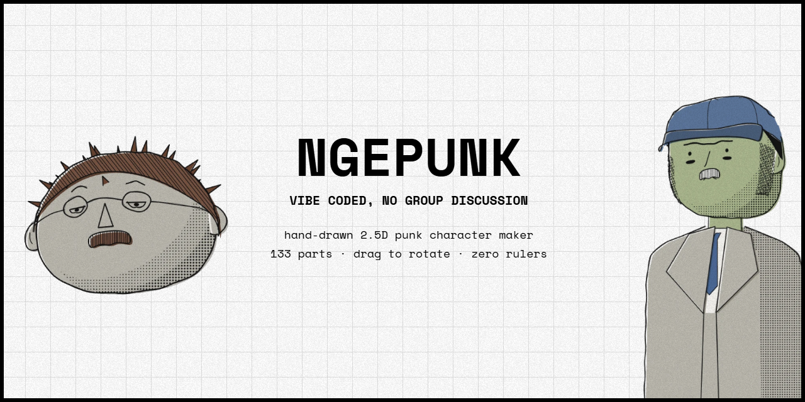
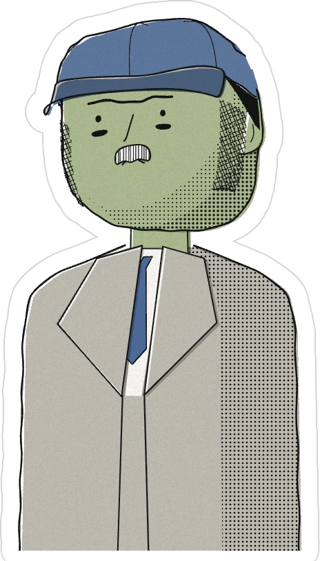

<p align="center"></p>
# NGEPUNK

> **Vibe coded, no group discussion.**
> Wobbly ink. Crooked heads. Off-register color. Zero rulers were harmed.

ngepunk is a character maker for people who think clean vector avatars are a crime.
Every head is drawn live in JavaScript as shaky hand-inked lines, then **turned like a 3D object** —
spin it, nod it, tilt it, look at the back of its skull. It's flat 2D drawing pretending to be 3D, and it doesn't care what you think.

Inspired by sketchbook grids of doodled heads and the Spider-Punk zine look: photocopy grain, halftone dots, misprinted color, safety pins.

---

## What's in the box

**137 parts across 13 categories**, all mixable, all rotatable:

| Category | Count | Highlights |
|---|---:|---|
| Character | 2 | human, cat |
| Head shape | 9 | round, egg, square, pear, long, potato, bean, chin, wide |
| Ears | 7 | normal, big, small, pointy, gauged, cat, none |
| Eyes | 12 | ring, dot, sleepy, wink, X, spiral, cat slit, angry… |
| Brows | 7 | line, thick, angry, worried, unibrow… |
| Nose | 9 | line, hook, beak, long, snub, cat… — sticks out in profile |
| Mouth | 13 | smirk, grin, teeth, tongue, fangs, cat, rose in the teeth… |
| Hair + fur | 17 | mohawk, liberty spikes, afro, bowl, long, bun, tabby / patches / tux fur |
| Beard | 7 | stubble, goatee, full, chinstrap, chops, soul patch |
| Mustache | 6 | chevron, pencil, handlebar, walrus, curly |
| Headwear | 17 | beanie, cap, flat cap, bandana, hero cowl, lens mask, luchador, **turban, peci low / mid / tall, blangkon, helm bogo**, plus a **hijab** layer that works under any of them |
| Eyewear | 9 | round, square, shades, cat-eye, monocle, eye patch, visor, domino mask |
| Punk bits | 16 | nose ring, brow bar, hoops, safety pin, lip ring, teardrop, tribal, barbed wire, spike crown, studded choker, scar… (stack as many as you want) |
| Half body | 8 | none, stick + bow tie, tee, stripes, hoodie, punk jacket, turtleneck, suit |

Plus **15 colors** for skin, hair, clothes and headwear, **3 fill styles** (offset misprint, scribble, flat),
**6 backgrounds** (grid, zine collage, paper, halftone, white, transparent), and sliders for eye spacing, feature height, feature size, ink weight, wobble and misregistration.

**Possible faces:** about **766 billion** from the single-pick parts alone. Add the punk bits and it's around **50 quadrillion**.
Add colors and you're past **10²¹**. You will not run out. Neither will your friends.

---

## Features

- **Turn it, don't redraw it.** Drag the canvas, or hit Front / ¾ / Side / Back. Spin mode turns it like a record.
- **Line boil.** Lines re-jitter at 12 fps ("on twos"), like hand-drawn animation. Toggle it in Scene.
- **Halftone shading** that stays fixed to the light while the head turns.
- **Shuffle** (button or the `R` key) always rolls something punk: 1–2 piercings, usually a tattoo,
  often spikes. Hijab, peci and turban included — culture and spikes are not mutually exclusive.
- **Collection** — 12 random heads on top (folded on phones). Click one to steal it into the editor; your scene settings stay. Shuffle the whole batch whenever.
- **Every part group folds open**, and its tiles show just that part on a bare head, so you see what you pick.
- **New mouth: chomp**, a chunky striped bite under the nose.
- **Export PNG** — 1000×1000, grain and all. Pick the **transparent** background to export a clean cut-out.
- **Die-cut sticker** (Scene → Effects) — a sticker border around the whole character, in any color, with optional thin grid-paper rules and adjustable thickness. Pair it with transparent and you've got a ready-to-print sticker.
- **Remembers your character** in the browser, so a refresh doesn't wipe your masterpiece.
- **Creator card** — tap "creator" in the top line.

---

## Tech

- **Preact + HTML Canvas 2D**, bundled by **esbuild** into one file. Every stroke is computed on the fly.
- Each feature lives on a virtual head ellipsoid (longitude / latitude), gets rotated in 3D, projected flat,
  then inked with a wobbly double stroke. That's the whole trick.
- **JetBrains Mono**, always dark, in the same look as [alviy.dev](https://alviy.dev).

| File | What it does |
|---|---|
| `src/engine.js` | the drawing engine: projection, ink, hair, faces, hats, bodies, backgrounds |
| `src/Punk.jsx` | the page: collection, canvas, pose, part sections, creator card, render loop |
| `public/` | what gets deployed: `index.html`, the built `app.js`, `assets/` |
| `build.mjs` | bundles `src/` into `public/app.js` |
| `serve.cjs` | tiny local server for `public/` |

---

## Run it

You need **[Node.js](https://nodejs.org)** and a browser.

```bash
git clone https://github.com/Masrurri/ngepunk.git
cd ngepunk
npm install
npm run build
npm start
```

Open **http://localhost:5177**. `npm run dev` rebuilds on save. After changing `src/`, run `npm run build`
and commit `public/app.js` too: Cloudflare serves `public/` as it is (`wrangler deploy`).

**Controls**

| Do | How |
|---|---|
| Rotate | drag the canvas, or the Pose sliders |
| Shuffle | `R` or the Shuffle button |
| Pick parts | open a section on the right, tap a tile |
| Save | Export PNG |

---

## License — no commercial use

**[PolyForm Noncommercial 1.0.0](LICENSE)** · © 2026 alviy

Use it, fork it, remix it, print stickers for your friends, put it in your portfolio, learn from the code —
all good. **Selling it or using it for a business is not**, unless you get permission first.
Hobby, personal, study, research, charity and school use are fine. Read [LICENSE](LICENSE) for the exact words.

---

<p align="center">
  
</p>

<p align="center">
  Vibe coded by <b>alviy.dev@gmail.com</b><br>
  Instagram <b>@rurrii</b> · Threads <b>@rurrii</b>
</p>

<p align="center"><i>Stay loud. Stay crooked. Draw your own face.</i></p>
